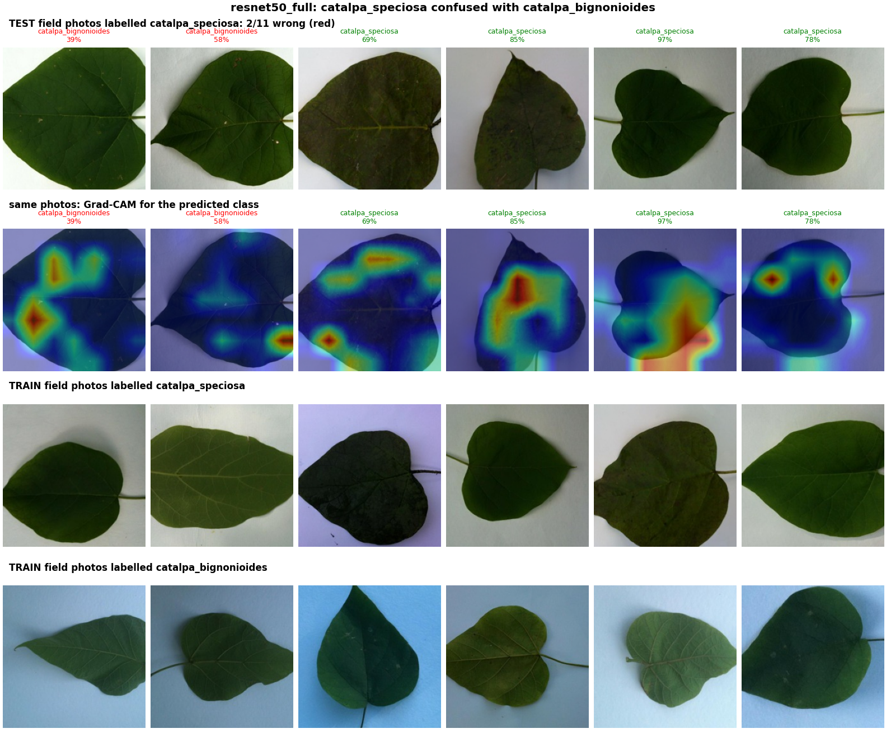

# 🍁 LeafID: Tree Species Identification with Transfer Learning

> CSCI 4052U Machine Learning II, Final Project · *Project ID: TODO (from TA)* · *Team: TODO*

[](https://colab.research.google.com/github/akshayanbalathas/leafid/blob/main/notebooks/LeafID_Colab.ipynb)

Upload a photo of a leaf; LeafID identifies the tree species (185 species), shows a Grad-CAM heatmap of
where the model looked, and writes a species card with look-alikes and Ontario native/invasive status.

**Demo video:** TODO · **Slides:** TODO

---

## 1. The problem

**Task.** Given a phone photo of a single leaf, name the tree species (one of 185 species of northeastern North
America), show which part of the leaf the decision was based on, and say whether that tree is native, non-native
or invasive in Ontario.
*Input:* an RGB photo. *Output:* the top-3 species with probabilities, a Grad-CAM heatmap and a species card.

**Why it matters.** Invasive trees such as Norway maple, tree-of-heaven and Amur maple crowd out native forest
in southern Ontario, and identifying a tree is the first step before reporting or removing it. Non-experts mix
up look-alikes: Norway maple is easily taken for the native sugar maple.

**Why traditional computer vision falls short.** The original LeafSnap app (Kumar et al., 2012) segments the leaf
from a white background and compares hand-crafted histograms of the outline's curvature. That needs a flat,
complete leaf on a clean background, and it uses shape only. It ignores the veins, margin teeth and texture that
botanists use, and it breaks with shadows, colour casts, blur and folded or damaged leaves. Species whose
outlines nearly match, such as the two catalpas or two hickories, can't be separated by shape alone.

**Why a neural network, and why transfer learning.** A CNN learns margin, vein and texture features directly
from pixels. But we have only ~21k training images for 185 classes (~116 per species, and only ~26 *field*
photos per species), which makes learning from scratch harder. Our baseline CNN reaches 72% on field photos,
and the enhanced CNN reaches 86%. Starting from ImageNet features and fine-tuning reaches **97%** (section 3).

**Why not an off-the-shelf model.** A general vision-language model doesn't solve it either: CLIP zero-shot,
prompted with the 185 species names, gets only 4–6% of field photos right. The task needs supervised
fine-tuning on labelled leaves, which is what this project does.

**What makes the data hard (each measured in section 3):**
- **Two domains.** *Lab* images are clean scans of pressed leaves. *Field* images are phone photos of picked
  leaves on paper, with uneven lighting, colour casts and blur. The scratch CNN loses 9.5 points going from lab
  to field.
- **Fine-grained classes.** Many species pairs differ only in small leaf details.
- **Label noise.** We found 190 photos filed under two different species. Grad-CAM exposed the problem and file
  hashing confirmed it, and split v2 removes them.
- **Imbalance.** Some species have only 10 field photos, and four have none left after cleaning.

**How success is measured.** Top-1 and top-5 accuracy on held-out *field* photos, since those are what the app
sees, reported separately from lab photos. Models are selected on field validation accuracy, never on test.
The app must also behave safely: it refuses photos that aren't leaves (CLIP gate), and it shows guesses instead
of a confident card when the top probability is under 30%.

## 2. Neural network components

| Component | Architecture | Weights | Citation |
|---|---|---|---|
| Baseline CNN | 5 × (conv-BN-ReLU-pool) → GAP → FC | trained from scratch on LeafSnap | none |
| Enhanced CNN | 5 × (2 × conv-BN-ReLU, pool), widths 64–512 → GAP → dropout → FC | trained from scratch on LeafSnap | none |
| Residual CNN | stem + 4 residual stages → GAP → FC | trained from scratch on LeafSnap | He et al., 2016 |
| **ResNet-50 (main)** | 50-layer bottleneck ResNet, new 2048→185 head | ImageNet-pretrained, fine-tuned on LeafSnap | He et al., 2016; Deng et al., 2009 |
| Leaf gate + zero-shot baseline | CLIP ViT-B/32 zero-shot | pretrained (400M image-text pairs) | Radford et al., 2021 |
| Species card | Qwen2.5-1.5B-Instruct | pretrained, prompted only | Qwen Team, 2024 |
| Explainability | Grad-CAM (no weights) | none | Selvaraju et al., 2017 |

**Dataset:** LeafSnap: 185 tree species of the northeastern US, ~23k *lab* images (scans of pressed leaves) and
~7.7k *field* images (phone photos of picked leaves on paper). Kumar et al., ECCV 2012. After removing duplicates
(split v2): 29,945 images. See [`data/README.md`](data/README.md).

### How each model's weights were obtained

- **Scratch CNNs** (`simple_cnn`, `enhanced_cnn`, `res_cnn`): PyTorch's default random initialization, then
  trained by us on the LeafSnap training split only (30 epochs, AdamW, lr 1e-3).
- **ResNet-50:** torchvision's `ResNet50_Weights.IMAGENET1K_V2`, trained by the PyTorch team on ImageNet-1k
  (1.28M photos, 1,000 everyday object classes; 80.9% ImageNet top-1), downloaded automatically. We replace its
  1000-way output layer with a new, randomly initialized 2048 → 185 layer. Fine-tuning has two stages:
  1. 3 epochs training only the new layer, with the backbone frozen;
  2. 12 epochs training everything, with the backbone at a 10× smaller learning rate (1e-4 vs 1e-3), so the
     ImageNet features are adjusted rather than overwritten.
- **CLIP ViT-B/32** (leaf gate and zero-shot baseline; ViT-L/14 in the baseline only): OpenAI's weights
  (`openai/clip-vit-base-patch32` on Hugging Face), trained contrastively to match ~400M image–caption pairs
  collected from the internet. Used as-is, with no fine-tuning: we only write the text prompts.
- **Qwen2.5-1.5B-Instruct:** `Qwen/Qwen2.5-1.5B-Instruct` on Hugging Face (Apache 2.0). It was pretrained by
  Alibaba's Qwen team on up to 18 trillion tokens of multilingual web text, code and maths. It was then
  instruction-tuned on over a million supervised examples, followed by reinforcement learning from preference
  feedback (Qwen Team, 2024). We don't fine-tune it: it is prompted with facts from `assets/species_info.csv` and
  told not to contradict them, with greedy decoding so the same input gives the same card.
- **Grad-CAM:** no weights of its own. It reuses the classifier's gradients and activations at the last
  convolutional stage.

**Training:** cross-entropy (label smoothing 0.1), AdamW, cosine LR schedule, mixed precision.
ResNet-50 uses two-stage fine-tuning: backbone frozen for the first epochs (head only), then unfrozen with a
10× smaller backbone learning rate. Model selection on **field** validation accuracy.

## 3. Experiments and results

All runs share one fixed split (`splits/splits.csv`, stratified per species and source; photos of the same
pressed specimen never cross splits). Test accuracy is reported separately for lab and field images.

| Run | What it tests | Params | Lab top-1 | Field top-1 | Field top-5 |
|---|---|---|---|---|---|
| random guess | chance level (1 / 185) | none | 0.5% | 0.5% | 2.7% |
| `clip_zeroshot` | CLIP ViT-B/32, no training (species names as prompts) | 151M | 1.9% | 4.0% | 11.3% |
| `clip_zeroshot_L14` | CLIP ViT-L/14, no training | 428M | 5.6% | 6.0% | 23.6% |
| `simple_cnn` | small CNN from scratch | 1.0M | 81.6% | 72.1% | 93.8% |
| `enhanced_cnn` | deeper CNN from scratch | 9.5M | 92.7% | 86.2% | 99.0% |
| `res_cnn` | + residual connections (ResNet-18 layout) | 11.3M | 91.2% | 84.4% | 98.0% |
| `resnet50_probe` | pretrained features, head only | 23.9M (0.4M trained) | | | |
| `resnet50_full` | full two-stage fine-tune | 23.9M | **96.9%** | **97.1%** | **99.7%** |
| `resnet50_labonly` | trained on lab only → domain shift | 23.9M | | | |
| own Ontario photos | real-world check | | | | |

All numbers are on the held-out **test** split of split v2 (3,221 lab / 1,056 field images, duplicates removed,
see below), using each run's best epoch by field validation accuracy. Times are on a free Colab T4.
Params: weights in the architecture with the 185-way head (`python -m leafid.models`); CLIP counts are the
whole image + text model.

- **CLIP zero-shot** (no training, `python -m leafid.zeroshot`): better than chance but far from usable. The
  bigger ViT-L/14 roughly doubles top-5, yet still gets only 6% of field photos right. CLIP collapses onto a few
  names (ViT-B/32 puts 43% of field photos into just 5 of 185 species) and its mistakes often stay in the right
  genus (pine → pine, maple → maple, willow → willow): it knows roughly what a pine looks like, but not the
  difference between 185 Latin names. That's the gap the fine-tuned model fills with 22k labelled photos.
- `simple_cnn`: 30 epochs (~172 s each), best at epoch 29, still slowly improving.
- `enhanced_cnn`: 30 epochs (~249 s each), best field validation accuracy first reached at epoch 29
  (tied at epoch 30). Field test top-1 improves by 14.1 percentage points over `simple_cnn`
  (86.2% vs 72.1%) and by 1.8 points over `res_cnn`.
- `res_cnn`: 30 epochs (~187 s each), best field validation accuracy at epoch 30. Field test top-1
  improves by 12.3 percentage points over `simple_cnn` (84.4% vs 72.1%).
- All three scratch CNNs were still improving when training stopped (best epochs 29–30), so longer training would
  probably add a few points. We kept 30 epochs for each so they all get the same training budget.
- `resnet50_full`: 15 epochs (3 frozen at ~175 s, 12 unfrozen at ~200 s), best at epoch 11. Unfreezing the backbone
  at epoch 4 lifts field validation accuracy from ~50% to ~85% in one epoch.
- **Transfer learning wins by 25 points over the baseline CNN on field photos**, in half the epochs. The pretrained model also closes
  the lab → field gap (lab 96.9% vs field 97.1%), while the baseline CNN loses 9.5 points on real photos. Caveat:
  the four species that lost all their field photos (below) are absent from the field test set.
- **Pretraining, not size, explains most of the gap.** `res_cnn` has the same layout as ResNet-18 and half of
  ResNet-50's parameters (11.3M vs 23.9M). Trained from scratch it reaches 84.4% on field photos, against 97.1%
  for the fine-tuned ResNet-50. Growing the scratch CNNs from 1.0M to ~10M parameters gains 12–14 points;
  starting from ImageNet weights adds another 11–13. Bigger scratch models also shrink the lab → field gap
  (9.5 points for `simple_cnn`, 6.5–6.8 for the larger two) but don't close it. Residual connections don't help
  at this depth: the plain `enhanced_cnn` slightly beats `res_cnn` (86.2% vs 84.4%), since skip connections pay off
  in much deeper networks. A fully controlled test of pretraining would be `resnet50_scratch` (same architecture,
  random weights), which is optional in `BACKLOG.md`.
- **Remaining ResNet-50 errors are botanically reasonable:** at most 2 test photos per pair, e.g. northern vs
  southern catalpa, two serviceberries (`amelanchier`), two hickories (`carya`), two crabapples (`malus`).
  For its most-confused pair (below, from `python -m leafid.explain --run resnet50_full`) the model gets 9 of 11
  northern catalpa photos right, is unsure on the 2 it misses (39% and 58%), and its Grad-CAM attention sits on
  the leaf blade and margin rather than the background. The two species' leaves are nearly identical; field
  guides separate them by flowers and seed pods.



**Split v1 results (superseded).** Before we found the duplicates: `simple_cnn` 81.9% / 72.1% / 94.2%
(30 epochs, ~185 s each on a T4); `resnet50_full` 97.6% / 93.1% / 99.7% (15 epochs, 3 frozen). Unfreezing the
backbone at epoch 4 lifted field validation accuracy from 49% to 83% in one epoch. Reports in `reports/v1/`.

### Finding: duplicate and conflicting labels in LeafSnap

`resnet50_full` predicted **every** `pinus_virginiana` (Virginia pine, needles) test photo as `prunus_virginiana`
(chokecherry, broad leaves). Grad-CAM showed the model looking at the needles, not the background, and the
training photos labelled chokecherry included pine needles. Hashing every file showed why: the 7,719 field
files hold only 7,201 distinct photos, and **190 photos are filed under two different species**:

| Identical photos filed under both | Photos |
|---|---|
| `prunus_sargentii` + `quercus_muehlenbergii` | 66 |
| `prunus_subhirtella` + `prunus_virginiana` | 47 |
| `pinus_virginiana` + `prunus_virginiana` (all 45 pine field photos) | 45 |
| `magnolia_stellata` + `magnolia_tripetala` | 32 |

These four pairs were exactly the six most-confused pairs in v1. Exact copies within a species also crossed the
train/test boundary: 114 field photos and 58 lab photos (saved under different file names, so the specimen
grouping missed them). Split v2 (`python -m leafid.splits`) hashes every image, drops photos with conflicting
labels, keeps one copy of same-species duplicates, and lists what it dropped in `splits/dropped.csv`.
Every checkpoint records the split it was trained on, and `evaluate` refuses to score a model on a different one.

| Split | Images | Dropped: conflicting labels | Dropped: duplicate copies |
|---|---|---|---|
| v1 | 30,866 | | |
| v2 | 29,945 (lab 22,934 · field 7,011) | 531 field files | 213 lab + 177 field |

v2 test set: 3,221 lab / 1,056 field images. Side effect: `pinus_virginiana`, `quercus_muehlenbergii`,
`prunus_subhirtella` and `magnolia_tripetala` lose **all** their field photos (every one was a conflicting copy),
so they are learned from lab photos only and have no field test score (`ulmus_procera` never had field photos).

TODO: training-curve and confusion-matrix figures.

## 4. Application pipeline

```
photo ─▶ CLIP leaf gate ─▶ preprocess ─▶ ResNet-50 ─▶ softmax ─▶ top-3 species
         (reject non-leaf)  224×224,        [1,3,224,224]   [1,185]      │
                            ImageNet norm                                ├─▶ Grad-CAM ─▶ heatmap overlay
                                                                         └─▶ species_info.csv + LLM ─▶ species card
```

- **Data → tensor:** RGB image → resize 256 → center crop 224 → `/255` → normalize with ImageNet mean/std →
  `[1, 3, 224, 224]` (`src/leafid/data.py`).
- **Tensor → data:** logits `[1, 185]` → softmax → top-k indices → species names (`splits/classes.txt`) →
  facts from `assets/species_info.csv` → LLM prompt → markdown card (`src/leafid/predict.py`).
- **Interface:** the app calls a single `Predictor` object; each model is wrapped in its own module.
- **Low confidence:** if the top probability is under 30%, the app shows its guesses instead of a card.

## 5. Run it

**Colab (recommended, free T4):** open the notebook badge above, choose a T4 GPU, and run sections 1–3 every
session (setup, Google Drive, data). Then run only the cells you need. The notebook is built for free-tier limits:

- **Disconnect-proof:** checkpoints and reports are written to Google Drive after every epoch, and every training
  cell uses `--resume`. After a disconnect, re-run sections 1–3 and then the same training cell; it continues from
  the last finished epoch.
- **Fast data loading:** `python -m leafid.cache` shrinks every image once to 256 px on the local disk, so training
  doesn't re-decode 800×600 JPEGs on Colab's 2 CPUs every epoch. Loaders switch to the cache automatically.
- **Smoke test first:** section 4 runs a 2-epoch check of the whole pipeline and reports seconds per epoch.

**Local (GPU with >10 GB VRAM):**
```bash
pip install -r requirements.txt && pip install -e .
# put the Kaggle dataset anywhere under data/ (the code searches for it), or point LEAFID_DATA at it
python -m leafid.cache                       # optional: one-time resize, faster training
python -m leafid.train --model resnet50 --epochs 15 --freeze-epochs 3 --run resnet50_full --resume
python -m leafid.evaluate --checkpoint checkpoints/resnet50_full.pt
python app/app.py --checkpoint checkpoints/resnet50_full.pt
```

| Environment variable | Purpose | Default |
|---|---|---|
| `LEAFID_DATA` | folder to search for the LeafSnap dataset | `data/` |
| `LEAFID_CACHE` | pre-resized image cache | `data/cache_256` |
| `LEAFID_OUTPUT` | where `checkpoints/` and `reports/` are written (Colab: Google Drive) | repo root |

## 6. Repository layout

```
app/app.py                  Gradio UI
assets/species_info.csv     common names + Ontario status (facts the LLM must not change)
data/                       dataset goes here (git-ignored)
notebooks/LeafID_Colab.ipynb  end-to-end Colab runner
reports/<run>/              history.csv, metrics.json, confusion matrix, confusions.csv
splits/                     the shared fixed split (commit this!)
src/leafid/
  config.py      paths + constants          models.py    CNN / ResCNN / ResNet-50 + checkpoints
  splits.py      build the fixed split      train.py     resumable training loop (two-stage fine-tune)
  cache.py       one-time 256 px image cache
  data.py        image ↔ tensor, loaders    evaluate.py  lab/field top-1/top-5, confusions
  gradcam.py     Grad-CAM + overlay         explain.py   Grad-CAM figure of the most-confused pair
  leaf_gate.py   CLIP zero-shot leaf check  zeroshot.py  CLIP zero-shot species baseline
  species_card.py  LLM species card         predict.py   end-to-end Predictor
```

## 7. Screenshots

TODO

## 8. Team workflow and timeline

**Workflow:** never push to `main` directly. Branch per task (`cnn-baseline`, `resnet-runs`, `app-gradcam`, …),
open a pull request, and have one teammate glance at it before merging. Never commit `data/`, checkpoints, or keys
(see `.gitignore`). `splits/splits.csv` is generated **once** in Colab and committed; never regenerate it, or
results stop being comparable. (It was regenerated once, as v2, to remove duplicate photos; all runs use v2.)

**Roles:** TODO (agree on these in the group chat).

**Target: submit by the first week of December** (internal deadline Thu Dec 3, leaving a buffer).

| Week | Goals |
|---|---|
| Nov 16 – 22 | Repo up · `splits.csv` committed · scratch CNN baseline (Tue Nov 17) · first ResNet-50 run · roles agreed |
| Nov 23 – 29 | All experiments run + evaluated · app working end-to-end in Colab · `species_info.csv` completed and verified · **feature freeze Sun Nov 29** |
| Nov 30 – Dec 3 | README results + screenshots · slides (PDF) · ≤10-min video showing the app **and** the repo · submit |

**Open TODOs:** see [`BACKLOG.md`](BACKLOG.md) (experiments, species data, app, write-up, slides, video).
Note: `assets/species_info.csv` is only partly verified; see [`assets/README.md`](assets/README.md).

## References

- N. Kumar et al. *Leafsnap: A Computer Vision System for Automatic Plant Species Identification.* ECCV 2012.
- K. He, X. Zhang, S. Ren, J. Sun. *Deep Residual Learning for Image Recognition.* CVPR 2016.
- J. Deng et al. *ImageNet: A Large-Scale Hierarchical Image Database.* CVPR 2009.
- A. Radford et al. *Learning Transferable Visual Models From Natural Language Supervision (CLIP).* ICML 2021.
- R. Selvaraju et al. *Grad-CAM: Visual Explanations from Deep Networks via Gradient-based Localization.* ICCV 2017.
- Qwen Team. *Qwen2.5 Technical Report.* 2024.
